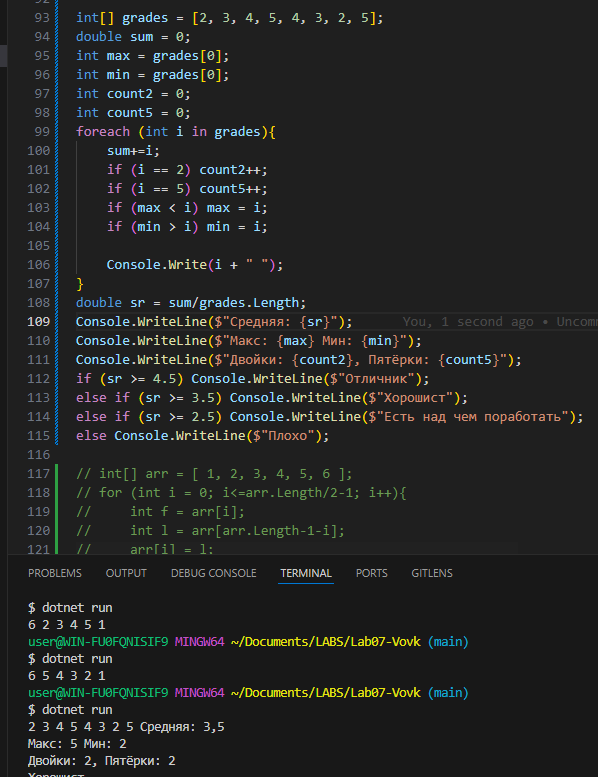
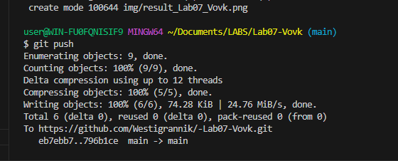

# Практическая работа №7
**ФИО: Вовк Тимофей Евгеньевич**
**Группа: ИСП-242**
**Дата:14.10.2026**
## Что изучено
- Изучили как делать массивы
- Как работать с массивами
- Как изменять данные в массивах

